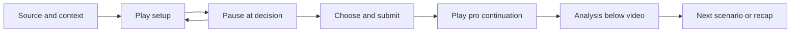

# Milestone two implementation plan

Status: **approved and implemented; automated checks pass; live-browser and audio acceptance remain pending**. The frontend and backend agents completed their builds. Verification results appear below.

The milestone replaces the active catalogue with the three real POV moments in [the scenario review](vod-scenarios.md). A learner watches a lead-in, answers while the video remains paused, then sees the pro's continuation with advanced analysis below it. Matching the pro and making a defensible decision are independent outcomes.

## Scope and stack

Keep the installed Next.js App Router, React, TypeScript, Tailwind, Vitest and Testing Library stack. Use the official YouTube IFrame API for source playback. Store curated content and AI-authored analysis as server-only TypeScript fixtures; no live AI service or API key is needed for the demo.

This milestone adds three VOD scenarios, persistent paused-video interaction, source/context information, advanced conditional feedback, and an updated recap. Login, learner/creator permissions, uploading, database persistence, whole-VOD extraction, creator approval tools and deployment remain future work. Their roadmap requirements remain in the README.

## Learner flow



Keep the YouTube player mounted through setup and decision. The current static-image replacement cannot provide this behaviour. Replaying setup preserves the selected option; answering locks the choice. After submission, start the continuation and display analysis beneath it. If the browser blocks playback, show a clear Play continuation control. A learner can review setup or continuation after answering without creating another attempt.

Show a concise source line, round context, observable facts and relevant unknowns. Feedback contains the observed pro action, same/different comparison, assessment of the selected option, conditions for alternatives, risks, and an AI-analysis notice. The recap reports choices and reasoning; a pro-match count must not be labelled skill accuracy.

Scenarios 2 and 3 are an explicitly linked pair. Give scenario 3 its own updated context. The demonstration covers one player, map and recording; broader content diversity comes later.

## Shared data contract

Extend `MediaAsset` with a `youtube` variant containing `videoId`, `startSeconds`, `endSeconds`, `alt` and optional `caption`. Preserve the existing image/native-video rendering branches.

Make the decision representation a union:

- `image`: existing decision image and accessible description.
- `paused-video`: the decision time and accessible description; the frame stays in the persistent player.

Add safe source attribution, `knownFacts`, `unknowns`, and an optional linked-scenario identifier to challenge details. Source metadata records player, uploader, source URL, ranked/tournament classification and verified map/round facts. Leave unsupported patch or match identifiers unknown.

For VOD answer responses, add:

```ts
observedAction: { optionId: string; description: string };
matchesPro: boolean;
analysis: {
  author: "ai";
  notice: string;
  rationale: string;
  limitations: string[];
};
```

Extend option feedback with `acceptableWhen: string[]` and `risks: string[]`. Compute `matchesPro` by comparing the selected ID with the observed-action ID; never compute it from an assessment.

Keep the existing assessment union (`recommended`, `reasonable`, `risky`), but allow **zero recommended options** and several reasonable options. The current client rejects an empty recommended list; that validation must change. The pro's action does not have to be recommended. UI wording can be “Preferred under these assumptions”, “Defensible”, and “Risky”, with the conditions alongside it.

The three API routes and `{ optionId }` request remain. Initial GET payloads must exclude assessments, observed action, `matchesPro`, reasoning, outcome and reveal bounds. Source URLs are public: this controls educational disclosure in the ordinary app flow, not access to the original VOD. Comparison fields must not imply a pro was involved when rendering an illustrative regression fixture.

Keep internal source-review notes server-only, with assistant review attribution and separate states for visual review, audio review and embed verification. Approval of this plan is not evidence that playback tests passed.

## Proposed file tree

`M` means modify; `N` means add after approval. Documentation and evidence already created for review are marked `R`.

```text
would-you-peek/
├── README.md                                      M
├── docs/
│   ├── milestone-2-plan.md                         R
│   └── vod-scenarios.md                            R
├── artifacts/vod-review/*.jpg                      R
├── src/
│   ├── contracts/challenge.ts                      M
│   ├── server/challenges/
│   │   ├── data.ts                                 M
│   │   └── service.ts                              M
│   ├── lib/
│   │   ├── client/challenge-api.ts                  M
│   │   ├── session/session-reducer.ts              M
│   │   └── video/
│   │       ├── youtube-api.ts                      N
│   │       └── segment-controller.ts               N
│   ├── hooks/use-challenge-session.ts              M
│   ├── components/challenge/
│   │   ├── YouTubeScenarioPlayer.tsx               N
│   │   ├── ScenarioMedia.tsx                       M
│   │   ├── ChallengePlayer.tsx                     M
│   │   ├── FeedbackPanel.tsx                       M
│   │   └── SessionRecap.tsx                        M
│   └── app/
│       ├── page.tsx                                M
│       └── globals.css                             M
└── tests/
    ├── backend/
    │   ├── challenge-data.test.ts                  M
    │   ├── challenge-service.test.ts               M
    │   └── challenge-routes.test.ts                M
    └── frontend/
        ├── fixtures.ts                            M
        ├── challenge-api.test.ts                   M
        ├── session-reducer.test.ts                 M
        ├── use-challenge-session.test.tsx          M
        ├── challenge-player.test.tsx               M
        ├── scenario-media.test.tsx                 M
        ├── youtube-api.test.ts                     N
        ├── segment-controller.test.ts              N
        ├── youtube-scenario-player.test.tsx        N
        ├── feedback-and-recap.test.tsx             N
        ├── vod-api.test.ts                         N
        └── vod-session.test.tsx                    N
```

The existing route handlers remain thin service adapters; no new endpoint is required. `DecisionPanel.tsx` can retain its accessible radio/submit behaviour unless integration exposes a necessary adjustment. No production video files or captured decision screenshots will be placed in `public/` for the YouTube scenarios.

## File responsibilities and functions

| File | Planned functions and responsibilities | Verification |
| --- | --- | --- |
| `contracts/challenge.ts` | Types for YouTube segments, paused decisions, provenance, comparison and conditional analysis. No executable functions. | Type checking plus API contract tests. |
| `server/challenges/data.ts` | Three authored VOD records and internal review evidence. Extend `AuthoredChallenge`; no runtime AI generation. | Fixture invariants, valid references and complete content. |
| `server/challenges/service.ts` | `toDetail()` projects safe fields. `submitAnswer()` returns the observed action, computes the match, and independently selects assessment/analysis. Retain `findChallenge()`, `toSummary()`, `listChallenges()`, `getChallenge()` and `parseAnswerRequest()`. | No answer leakage, every offered option, empty recommended list, deterministic results and existing errors. |
| `lib/client/challenge-api.ts` | Extend `isMedia()` and add `isDecision()`, `isSource()` and `isAnalysis()`. Update `getChallenge()`/`submitAnswer()` response guards for ordered finite timestamps, option membership and consistent match flags. | Malformed success bodies become recoverable errors; valid ambiguous feedback is accepted. |
| `lib/video/youtube-api.ts` | `loadYouTubeApi()` shares one script-loading promise, handles timeout/error and permits retry. `createYouTubePlayer()` wraps construction, site origin and typed events. `describeYouTubeError()` produces actionable errors. | Concurrent load, successful readiness, timeout, retry, and provider-error mapping. |
| `lib/video/segment-controller.ts` | `validateSegment()` rejects invalid bounds. `getPlaybackInstruction()` decides continue/pause/reset from phase, approved bounds and observed time. Keep timing decisions pure and independent of React. | Exact boundary cases, early/late positions, replay and setup/reveal separation. |
| `YouTubeScenarioPlayer.tsx` | Persistent player. `handleReady()` prepares setup; `startSegment()` loads the approved interval; `checkPosition()` enforces the current boundary; `finishSetup()` pauses and calls completion once; `handleVisibilityChange()` pauses in background; `handleError()` and `retryPlayer()` preserve progress. Cleanup cancels timers and destroys the player. | Mocked lifecycle, single completion, persistent instance, no premature reveal, autoplay fallback, retry and stale-event cleanup. |
| `ScenarioMedia.tsx` | Keep illustration and native video support. Route YouTube presentation through the persistent component without recreating it at the decision. | Existing media behaviour and failed-resource recovery regressions. |
| `ChallengePlayer.tsx` | Keep the player keyed by challenge ID, pass the correct phase and available bounds, render source/context, and place analysis below the continuation. | Complete session, setup replay, answer lock, keyboard focus and linked-scenario context. |
| `FeedbackPanel.tsx` | Render comparison separately from quality; show observed action, conditional alternatives, risks and AI inference. | Different-but-defensible, matched-but-risky and no uniquely preferred option. |
| `SessionRecap.tsx` | Present the choices, comparison and assessment independently; accurate VOD wording. | No false accuracy claim, review expansion and restart. |
| `session-reducer.ts` | Extend `sessionReducer()` transitions only where needed for paused-video media; retain `createInitialSessionState()`. Ignore duplicate/stale completion and preserve choices during setup replay. | Reducer transitions, replay, duplicate completion and restart. |
| `use-challenge-session.ts` | Adapt `useChallengeSession()` to the revised contract while retaining cancellation and submission guards. | Async success/failure, stale responses, retry and duplicate submission. |
| `app/page.tsx`, `app/globals.css` | Accurate real-POV/advanced-player copy; responsive player, source/context and feedback layout; visible keyboard focus. | Browser checks at desktop and narrow mobile sizes. |
| `README.md` | Update active scenario catalogue, behaviour, verification results and known playback limits after implementation. | Documentation agrees with actual tested behaviour. |

Names for new functions are proposed interfaces; implementation may combine private helpers where it improves clarity while retaining these responsibilities and checks.

## Playback constraints

Use the official IFrame API with source attribution. The API supports start/end bounds, but seeking cancels `endSeconds`; setup replay should reload its bounded segment. Start seeks can land near keyframes. A time monitor and phase-aware controller are required to pause before the action rather than relying on an unbounded iframe. Browser autoplay may be blocked, so explicit accessible playback controls and a fallback are necessary. Handle unavailable videos, embedding-disabled errors and client-identity error 153. [YouTube IFrame API](https://developers.google.com/youtube/iframe_api_reference)

Use supported player parameters to reduce accidental seeking where suitable, with accessible controls outside the player. Preserve YouTube branding and normal source access; do not overlay the player to intercept interaction. The API does not guarantee frame-perfect isolation or prevent a learner opening the source. Select boundaries with a visible safety margin and verify them in a real browser. An uncontrollable or unavailable segment must be moved earlier or replaced before claiming completion. [YouTube player parameters](https://developers.google.com/youtube/player_parameters)

The video itself must remain readable on mobile. Respect the provider's minimum player viewport rather than shrinking a 16:9 embed below its supported dimensions.

## Tests and acceptance gates

### Automated checks

- **Content invariants:** three ordered scenarios; valid video/source IDs; same setup/reveal video; `start < decision < revealEnd`; finite nonnegative times; observed action references an offered option; complete analysis; linked scenario exists; recommended list may be empty.
- **Service and routes:** every answer path, safe GET projections, independently computed pro comparison and assessment, deterministic responses, invalid JSON/body/option and 404 handling. Include a test fixture where the pro's choice is risky and another where a different choice is defensible.
- **Client validation:** accept the new variants and ambiguous assessments; reject reversed/invalid bounds, malformed analysis/provenance, unknown observed-option IDs and inconsistent match flags.
- **Player integration:** setup completion fires once; player remains mounted at the decision; no continuation is supplied before submission; replay preserves choice; result and retry preserve progress; hidden-tab handling pauses; blocked autoplay exposes a control; stale events and timers are cleaned up when changing scenarios/unmounting.
- **Full flow:** all three scenarios, final feedback before recap, review/replay, restart and refresh reset. Preserve meaningful image/native-video regression coverage.

Run `npm test`, `npm run typecheck` and `npm run build` once implementation is integrated; rerun affected checks after fixes. Existing milestone-one results are not evidence for new YouTube behaviour.

### Real-browser checks for every scenario

1. Source embeds and plays; attribution and relevant HUD remain legible.
2. Setup begins at the approved lead-in and stops before action or audio gives away the choice. Perform a normal-speed audio/spoiler review.
3. The paused scene remains visible while selecting. Setup replay reaches the same boundary and retains the choice.
4. Submission resumes the actual continuation, with analysis below; blocked autoplay has a working explicit play fallback.
5. Post-answer replay does not change the answer or create another attempt.
6. Playback failure/retry, background-tab return, keyboard interaction, desktop and narrow mobile layout behave correctly.
7. Complete the session, inspect recap/restart/refresh, and check browser console errors.

Automated tests prove application behaviour, not tactical correctness, provider availability or absence of audio spoilers. Record those reviews separately.

## Build order after approval

1. Freeze the approved scenario records and shared contract, including the option to have no uniquely preferred answer.
2. Assign a backend agent to content, safe projections and backend tests; assign a frontend agent to persistent playback, feedback and frontend tests. Agree on shared fixtures before parallel edits.
3. Integrate and run automated checks. Correct validation and lifecycle failures before browser acceptance.
4. Review every real embedded boundary and audio interval. Adjust or replace any segment that fails the content/playback gate.
5. Deliver the local working milestone with screenshots, check results and clearly scoped remaining limitations.

**Approval recorded:** the user approved this three-scenario set and implementation plan and requested two new agents to build and test it. The linked-pair presentation is included in that approved scope.

## Implementation verification — 17 November 2026

- `npm test`: **203 passed across 15 files** (68 backend, 135 frontend).
- `npm run typecheck`: passed.
- `npm run build`: passed using Webpack; homepage, play page and all three API routes compiled.
- Built-server HTTP checks: 13 passed, covering the catalogue, each detail and every offered answer. Checked no-store responses, safe GET disclosure and independently computed comparisons.
- `vod-api.test.ts` connects real server projections to client response validation. `vod-session.test.tsx` runs the real three-scenario catalogue through the actual session/player components with a simulated YouTube provider. These supplement the planned unit and component tests.
- Player tests cover shared script loading and retry, ordered boundaries, persistent iframe/selection, early pause, continuation replay, decision-frame recovery, blocked autoplay, buffering watchdog cleanup, hidden-tab playback and stale completion events.

An initial real-browser probe confirmed that the selected source embeds and plays. It also showed the provider's end screen when playback reached the exact endpoint. The implementation now pauses 0.30 seconds early with a 75 ms time monitor. Browser control became unavailable before this final behaviour could be inspected, so this timing margin remains provisional.

The seven real-browser acceptance checks above remain pending for the final app, including normal-speed audio/spoiler review and desktop/mobile inspection. Source review metadata deliberately retains `audio: "pending"` and `embed: "pending"`. The earlier source screenshots document visual curation, not final application acceptance. No new app screenshots or live-browser success are claimed.

The temporary embed-probe page was removed, and the local production verification server was stopped. Accounts, creator tooling, extraction and deployment remain outside this milestone.
